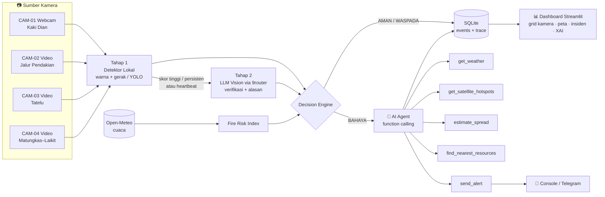

# 🔥👁️ MataKlabat

**Sistem Peringatan Dini Kebakaran Hutan & Lahan (Karhutla) Gunung Klabat berbasis Computer Vision, LLM, dan AI Agent.**

> *"Mata yang tidak pernah tidur untuk Gunung Klabat."*

MataKlabat memantau beberapa titik rawan di kawasan Gunung Klabat (Minahasa Utara, Sulawesi Utara) melalui kamera. Sistem mendeteksi **api, asap, dan potensi kebakaran**, lalu memutuskan status **AMAN / WASPADA / BAHAYA** disertai penjelasan (*Explainable AI*). Saat bahaya terkonfirmasi, **AI Agent** menyusun laporan insiden: arah sebaran api berdasarkan angin, desa yang terancam, pihak yang perlu dihubungi, dan rekomendasi tindakan.

Untuk demo, kamera lapangan disimulasikan dengan **webcam laptop** (1 kamera live) dan **file video** (kamera virtual lain).

---

## 📌 Latar Belakang Masalah

Pada **19 September 2026**, kebakaran terjadi di kaki Gunung Klabat sekitar **Monumen Kaki Dian, Airmadidi**. Dalam ±3 minggu api meluas dari **60 ha → ±300 ha → ±400 ha → ±651 ha**, termasuk ±131,59 ha **hutan lindung**, dan lebih dari **21 hari belum padam**. Kendala yang dilaporkan:

- medan terjal yang tidak bisa dimasuki kendaraan pemadam,
- angin kencang serta api yang merambat lewat akar di bawah tanah,
- **pemantauan satelit terhambat saat langit berawan**,
- titik api baru yang muncul di Matungkas dan Laikit.

Asap juga berpotensi mengganggu **Bandara Sam Ratulangi**. Status tanggap darurat diperpanjang hingga 21 Oktober 2026.

Analisis akar masalah lengkap ada di [`docs/RCA.md`](docs/RCA.md), termasuk Fishbone Diagram. Kesimpulannya: **tidak ada pemantauan darat yang kontinu, sehingga api diketahui dan ditangani setelah membesar.** MataKlabat menargetkan akar masalah ini.

---

## ✨ Fitur Utama

| # | Fitur | Keterangan |
|---|---|---|
| 1 | **Multi-camera monitoring** | Webcam, file video, atau RTSP/IP camera, dikonfigurasi di `config/cameras.yaml` |
| 2 | **Deteksi 2 tahap** | Tahap 1: detektor lokal cepat (warna + gerak, opsional YOLO). Tahap 2: **LLM Vision** (lewat 9router) memverifikasi dan menjelaskan |
| 3 | **Decision Engine** | Fusi skor lokal, verdict LLM, persistensi waktu, dan indeks risiko cuaca menjadi AMAN / WASPADA / BAHAYA |
| 4 | **Fire Risk Index** | Indeks 0–100 dari suhu, kelembapan, angin, dan hari tanpa hujan (Open-Meteo, gratis tanpa API key) |
| 5 | **Explainable AI** | Setiap keputusan menyimpan *decision trace*: input, aturan yang terpicu, dan alasan LLM |
| 6 | **AI Agent tindak lanjut** | Agent LLM dengan *tool calling*: cek cuaca, hotspot satelit, estimasi arah sebaran, sumber daya terdekat, susun dan kirim peringatan |
| 7 | **Dashboard** | Streamlit: grid kamera, **peta Klabat** dengan status tiap kamera, log insiden, grafik risiko, panel penjelasan |
| 8 | **Notifikasi** | Console, dan opsional **Telegram Bot** |
| 9 | **Evaluasi** | Script evaluasi pada test set (api, asap, kabut, senja, lampu, normal): precision, recall, false alarm, analisis kegagalan |

---

## 🏗️ Arsitektur Singkat



Detail komponen, aturan keputusan, skema JSON LLM, dan skema database ada di [`docs/ARCHITECTURE.md`](docs/ARCHITECTURE.md).

---

## 🚀 Quick Start

### Prasyarat
- Python **3.11+**
- Webcam (bawaan laptop sudah cukup)
- **[9router](https://github.com/decolua/9router)** berjalan (default `http://localhost:20128`), dengan model yang mendukung **gambar** dan **tool calling**
- (Opsional) Telegram Bot token dan NASA FIRMS MAP_KEY

### Instalasi

```bash
git clone https://github.com/tmthyjw23/MataKlabat.git
cd MataKlabat
python -m venv .venv
# Windows: .venv\Scripts\activate    |   macOS/Linux: source .venv/bin/activate
pip install -e .            # memasang paket mataklabat + semua dependensi
cp .env.example .env        # Windows: copy .env.example .env  — lalu isi LLM_API_KEY dan LLM_MODEL
```

### Menjalankan

Buka 2 terminal:

```bash
# Terminal 1 — monitor (membaca kamera, deteksi, keputusan, agent)
python -m mataklabat run

# Terminal 2 — dashboard
streamlit run app.py
```

Dashboard terbuka di `http://localhost:8501`.

### Perintah lain

```bash
python -m mataklabat check            # cek kamera, API key, koneksi cuaca
python -m mataklabat run --camera CAM-01   # jalankan satu kamera saja
python -m mataklabat run --no-llm     # hanya detektor lokal (hemat kuota)
python scripts/evaluate.py --set data/test_set --prompt v2   # evaluasi
pytest                                # unit test
```

---

## ⚙️ Konfigurasi

### `.env`

| Variabel | Wajib | Default | Keterangan |
|---|---|---|---|
| `LLM_MODEL` | ✅ | – | Nama model di 9router (wajib mendukung gambar dan tool calling) |
| `LLM_API_KEY` | | – | API key dari dashboard 9router |
| `LLM_BASE_URL` | | `http://localhost:20128/v1` | Endpoint OpenAI-compatible 9router |
| `LLM_MIN_INTERVAL_S` | | `8` | Jeda minimum antar panggilan LLM (menjaga kuota gratis) |
| `HEARTBEAT_S` | | `120` | Cek LLM berkala walau detektor lokal tenang (`0` = mati) |
| `TELEGRAM_BOT_TOKEN` | | – | Opsional, untuk notifikasi Telegram |
| `TELEGRAM_CHAT_ID` | | – | Opsional |
| `AUTO_SEND_ALERT` | | `false` | `true` = agent boleh mengirim Telegram otomatis |
| `FIRMS_MAP_KEY` | | – | Opsional, NASA FIRMS untuk hotspot satelit |

### `config/cameras.yaml`

```yaml
cameras:
  - id: CAM-01
    name: "Monumen Kaki Dian (Airmadidi)"
    source: 0                       # 0 = webcam laptop
    lat: 1.4205
    lon: 124.9850
    facing_deg: 60                  # arah hadap kamera (derajat, 0 = utara)
  - id: CAM-02
    name: "Jalur Pendakian Klabat – Pos 1"
    source: "data/videos/cam02.mp4" # file video diputar berulang
    lat: 1.4420
    lon: 125.0050
```

> ⚠️ Koordinat di contoh adalah **perkiraan**. Verifikasi di Google Maps sebelum demo.

---

## 🎬 Skenario Demo

Lihat [`docs/DEMO.md`](docs/DEMO.md). Ringkasnya:
1. Semua kamera **AMAN**, peta hijau, indeks risiko tampil.
2. Arahkan **video api/asap di layar HP** ke webcam. Status naik ke **WASPADA**, lalu **BAHAYA**.
3. AI Agent menyusun laporan insiden: arah angin, desa terancam, rekomendasi, pesan Telegram.
4. Uji **kegagalan**: foto kabut Klabat atau cahaya senja. Tunjukkan cara sistem (dan LLM) bisa tertipu.

> 🔒 **Jangan menyalakan api sungguhan di dalam ruangan.** Cukup pakai video atau foto api di layar.

---

## 📁 Struktur Proyek

```
mataklabat/
├── README.md
├── AGENTS.md                 # instruksi untuk AI coding agent
├── pyproject.toml            # paket Python (pip install -e .)
├── requirements.txt
├── .env.example
├── app.py                    # dashboard Streamlit
├── config/
│   ├── cameras.yaml          # daftar kamera & lokasi
│   └── resources.yaml        # posko, damkar, desa (untuk agent)
├── src/mataklabat/
│   ├── __main__.py           # CLI: run / check
│   ├── config.py             # load .env + yaml
│   ├── camera.py             # CameraSource (webcam/video/rtsp)
│   ├── detector.py           # Tahap 1: ColorMotionDetector (+ YoloDetector opsional)
│   ├── vision_llm.py         # Tahap 2: LLM Vision (9router) → JSON terstruktur
│   ├── prompts.py            # prompt v1 & v2 (untuk eksperimen)
│   ├── risk.py               # Open-Meteo + Fire Risk Index
│   ├── decision.py           # Decision Engine + state machine
│   ├── agent.py              # AI Agent (function calling)
│   ├── tools.py              # tool-tool agent
│   ├── notifier.py           # console / Telegram
│   ├── storage.py            # SQLite
│   └── pipeline.py           # loop per kamera
├── scripts/
│   └── evaluate.py           # evaluasi test set → metrics + CSV
├── data/
│   ├── videos/               # video demo (tidak di-commit jika besar)
│   ├── test_set/{fire,smoke,fog,sunset,lights,normal}/
│   └── runtime/              # events.db, snapshots (gitignored)
├── tests/
├── tasks/                    # rencana build (plan.md, todo.md)
└── docs/
    ├── PRD.md
    ├── ARCHITECTURE.md
    ├── RCA.md                # Root Cause Analysis + Fishbone
    ├── DEMO.md
    └── assets/fishbone.png
```

---

## 🧠 Bagaimana AI Mengambil Keputusan?

MataKlabat **tidak** langsung memercayai satu model. Keputusan diambil dari beberapa bukti:

1. **Detektor lokal** (murah, cepat, sensitif) menangkap piksel berwarna api atau asap yang **bergerak**. Banyak false alarm, tapi jarang melewatkan kejadian.
2. **LLM Vision** (mahal, lambat, kontekstual) memastikan apakah itu benar api/asap atau **lookalike** (kabut, awan, senja, lampu, debu, uap). LLM mengembalikan `confidence` dan alasan.
3. **Persistensi**: bukti harus muncul berulang, bukan hanya di satu frame.
4. **Konteks cuaca**: saat Fire Risk Index tinggi (kering dan berangin), ambang BAHAYA sedikit diturunkan.

Setiap keputusan menyimpan **decision trace** yang bisa dibuka di dashboard, misalnya:

```
BAHAYA ← rule R1: llm.smoke_visible=true, confidence=0.86 ≥ 0.70 (risk=72 → ambang 0.60),
         lookalike=none, terkonfirmasi 2/3 cek terakhir
         LLM: "Terlihat kolom asap abu-abu pekat naik dari vegetasi di lereng kiri,
               bentuk bergulung dan pangkalnya menyatu dengan tanah — bukan kabut."
```

Keterbatasan dan analisis kegagalan (kabut dikira asap, senja dikira api, asap tipis jauh tidak terdeteksi) ada di [`docs/ARCHITECTURE.md`](docs/ARCHITECTURE.md#8-analisis-kegagalan-yang-diharapkan) dan hasil `scripts/evaluate.py`.

---

## ⚠️ Keterbatasan

- Ini **prototipe akademik**, bukan pengganti sistem resmi BPBD, Manggala Agni, atau BMKG.
- Kamera di dunia nyata membutuhkan daya, jaringan (4G/LoRa), pelindung cuaca, dan posisi tinggi. Semua itu di luar lingkup demo.
- LLM butuh 9router yang berjalan dan internet, serta kuota provider-nya terbatas. Karena itu detektor lokal tetap berjalan offline.
- Fire Risk Index adalah **heuristik sederhana**, bukan Fire Weather Index resmi.
- Deteksi malam hari dan asap sangat tipis/jauh masih lemah.

---

## 🗺️ Roadmap

- [ ] Model YOLO fire/smoke yang di-fine-tune dengan foto Klabat (termasuk kabut lokal)
- [ ] Kamera PTZ yang berputar 360°
- [ ] Integrasi resmi data hotspot (SiPongi KLHK / NASA FIRMS)
- [ ] Triangulasi lokasi api dari 2+ kamera
- [ ] Laporan warga via WhatsApp/Telegram sebagai sumber tambahan

---

## 👥 Tim

Tugas mata kuliah **Artificial Intelligence**, Fakultas Ilmu Komputer, Universitas Klabat.

| Nama | NIM | Peran |
|---|---|---|
| Timothy Jordy Weley | 105022410005 | |
| | | |

## 📚 Sumber

- detikSulsel: [Karhutla di Kaki Gunung Klabat Sudah 11 Hari Belum Padam](https://www.detik.com/sulsel/berita/d-8684921/karhutla-di-kaki-gunung-klabat-sudah-11-hari-belum-padam)
- detikSulsel: [Karhutla di Gunung Klabat 21 Hari Belum Padam, Ini Kendalanya](https://www.detik.com/sulsel/berita/d-8699946/karhutla-di-gunung-klabat-21-hari-belum-padam-ini-kendalanya)
- detikSulsel: [Karhutla di Gunung Klabat Meluas, 651 Hektare Lahan Hangus](https://www.detik.com/sulsel/berita/d-8702328/karhutla-di-gunung-klabat-meluas-651-hektare-lahan-hangus)
- Metro TV News: [BNPB: 60 Hektare Lahan di Kaki Gunung Klabat Terbakar](https://www.metrotvnews.com/read/KvJCJZAA-bnpb-60-hektare-lahan-di-kaki-gunung-klabat-terbakar)
- Teras Manado: [Karhutla Minut Bergerak ke Hutan Lindung Gunung Klabat](https://terasmanado.com/2026/10/01/karhutla-minut-bergerak-ke-hutan-lindung-gunung-klabat-joune-ganda-perkuat-koordinasi-penanganan/)
- Totabuan News: [Karhutla Rambah Hutan Lindung Gunung Klabat](https://totabuan.news/daerah/minut/karhutla-rambah-hutan-lindung-gunung-klabat-bupati-joune-ganda-waspadai-meluasnya-ancaman-ekologi-dan-ekonomi/)
- [Open-Meteo API](https://open-meteo.com/) · [9router](https://github.com/decolua/9router) · [NASA FIRMS](https://firms.modaps.eosdis.nasa.gov/)

## 📄 Lisensi

MIT. Lihat `LICENSE`.
