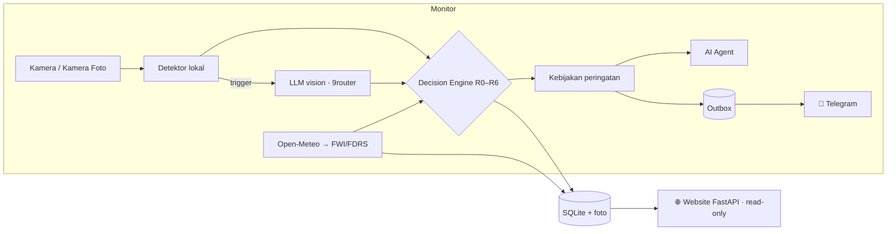

# 🔥👁️ MataKlabat

**Sistem pencegahan dan peringatan dini kebakaran hutan dan lahan (karhutla) Gunung Klabat, berbasis cuaca, Computer Vision, LLM vision, dan AI Agent.**

> *"Mata yang tidak pernah tidur untuk Gunung Klabat."*

MataKlabat memberi dua status yang terpisah:

| Status | Pertanyaan yang dijawab | Sumber |
|---|---|---|
| **Risiko Kebakaran Kawasan** (pencegahan) | Seberapa mudah kawasan Klabat terbakar hari ini? | Cuaca Open-Meteo → Fire Weather Index (FWI) Kanada → kelas **FDRS Indonesia**: Rendah / Sedang / Tinggi / Sangat Tinggi |
| **Status Kamera** (deteksi) | Apakah ada api atau asap sekarang? | Detektor lokal (warna + gerak) → **verifikasi LLM vision** → aturan R0–R6: Normal / Perlu Dicek / Kebakaran Terdeteksi |

Saat kebakaran terdeteksi, **Telegram** menerima foto dengan kotak deteksi, alasan, dan data yang dipakai. Sekitar satu menit kemudian **AI Agent** mengirim laporan insiden: arah sebaran api menurut angin, desa terancam, rekomendasi, dan pihak yang perlu dihubungi. Semua bisa dilihat di **website** (peta, kamera, risiko, insiden, kesehatan sistem).

Untuk demo, kamera lapangan disimulasikan dengan **webcam**, **video**, dan **Kamera Foto** (folder: foto yang diseret ke folder langsung "dilihat" kamera).

---

## 📌 Latar Belakang

Pada **19 September 2026** kebakaran terjadi di kaki Gunung Klabat sekitar **Monumen Kaki Dian, Airmadidi**. Dalam ±3 minggu api meluas dari **60 ha → ±651 ha**, termasuk ±131,59 ha **hutan lindung**, dan lebih dari **21 hari belum padam**. Pemantauan bergantung pada laporan warga dan **satelit yang buta saat berawan**, sehingga titik api baru (Matungkas, Laikit) baru diketahui setelah membesar.

Analisis akar masalah dan Fishbone: [`docs/RCA.md`](docs/RCA.md).

---

## ✨ Fitur

| Fitur | Keterangan |
|---|---|
| Risiko kawasan harian | FWI (Van Wagner 1987, penyesuaian lintang ekuator) + kelas FDRS Indonesia (de Groot dkk. 2006); prakiraan 3 hari |
| Multi-kamera | Webcam, video berulang, RTSP, dan Kamera Foto (folder) |
| Deteksi 2 tahap | Detektor lokal murah di setiap frame; LLM vision (via [9router](https://github.com/decolua/9router)) hanya saat dipicu |
| Keputusan yang bisa dijelaskan | Aturan R0–R6, konfirmasi 2 dari 3 cek, penolakan lookalike (kabut, senja, lampu), jejak keputusan untuk setiap event |
| Telegram bertingkat | Kebakaran Terdeteksi (langsung), Perlu Dicek (dibatasi; yang belum terverifikasi AI hanya di dashboard), risiko naik, ringkasan pagi; antrean dengan kirim ulang otomatis |
| AI Agent | Tool calling: cuaca, hotspot NASA FIRMS, arah sebaran, desa terancam, sumber daya; cadangan laporan template |
| Website | Dashboard live, peta topografi/satelit/jalan, detail insiden, kesehatan sistem; terang/gelap; bisa dibuka di HP |
| Standar production | Satu perintah `up`, restart otomatis, heartbeat, log berotasi, retensi data, 239 test otomatis |
| Evaluasi | Precision/recall/false alarm per kelas lookalike, perbandingan prompt v1 vs v2, uji konsistensi, analisis kegagalan F1–F5 |

---

## 🏗️ Arsitektur



Detail: [`docs/ARCHITECTURE.md`](docs/ARCHITECTURE.md) dan spec v2 [`docs/superpowers/specs/2026-10-26-mataklabat-v2-design.md`](docs/superpowers/specs/2026-10-26-mataklabat-v2-design.md).

---

## 🚀 Quick Start

> Panduan lengkap langkah demi langkah untuk tim (9router, Telegram, cek, latihan demo, masalah umum): [`docs/SETUP.md`](docs/SETUP.md). Pasang di VPS untuk demo online (systemd, nginx, Cloudflare, mode operator): [`docs/DEPLOY.md`](docs/DEPLOY.md).

### Prasyarat
- Python **3.11+**
- Webcam (opsional)
- **[9router](https://github.com/decolua/9router)** berjalan (default `http://localhost:20128`) dengan model yang mendukung **gambar** dan **tool calling**. Tanpa ini sistem tetap jalan dalam mode detektor lokal.
- (Opsional) Bot Telegram ([@BotFather](https://t.me/BotFather)) dan NASA FIRMS MAP_KEY

### Instalasi

```bash
git clone https://github.com/tmthyjw23/MataKlabat.git
cd MataKlabat
python -m venv .venv
# Windows: .venv\Scripts\activate    |   macOS/Linux: source .venv/bin/activate
pip install -e .
cp .env.example .env        # Windows: copy .env.example .env  — lalu isi LLM_MODEL, LLM_API_KEY, Telegram
```

### Menjalankan

```bash
python -m mataklabat check     # cek kamera, 9router, cuaca, Telegram
python -m mataklabat up        # monitor + website; buka http://127.0.0.1:8000
```

Ctrl+C menghentikan semuanya dengan bersih. Untuk membuka dashboard dari HP di Wi-Fi yang sama: `python -m mataklabat up --host 0.0.0.0` (hanya-baca; matikan setelah demo).

### Perintah lain

```bash
python -m mataklabat check --llm-sample foto.jpg   # kirim satu foto ke LLM, lihat verdict JSON
python -m mataklabat run --no-llm --duration 300   # monitor saja, tanpa LLM, 5 menit
python -m mataklabat web --port 8000               # website saja
python scripts/evaluate.py --set data/test_set --prompt v1,v2 --repeat 3
pytest -q
```

---

## ⚙️ Konfigurasi

### `.env`

| Variabel | Default | Keterangan |
|---|---|---|
| `LLM_MODEL` | – | Nama model di 9router (gambar + tool calling). Kosong = mode detektor lokal |
| `LLM_API_KEY` | – | API key dari dashboard 9router |
| `LLM_BASE_URL` | `http://localhost:20128/v1` | Endpoint OpenAI-compatible |
| `TELEGRAM_BOT_TOKEN`, `TELEGRAM_CHAT_ID` | – | Kosong = mode kering (pesan dibuat dan tampil di web, tidak dikirim) |
| `AUTO_SEND_ALERT` | `true` | `false` = mode kering |
| `FIRMS_MAP_KEY` | – | Opsional, hotspot satelit NASA FIRMS |
| `PUBLIC_URL` | – | Jika diisi, pesan Telegram menyertakan tautan ke dashboard |
| `MORNING_SUMMARY_AT` | `07:00` | Ringkasan pagi (WITA); kosong = mati |
| `LLM_MIN_INTERVAL_S`, `HEARTBEAT_S`, `RECHECK_S`, `CHECK_ALERT_COOLDOWN_S`, `CONF_DANGER`, … | lihat `config.py` | Semua konstanta bisa diubah lewat env |

### `config/cameras.yaml`

```yaml
cameras:
  - id: CAM-01
    name: "Monumen Kaki Dian (Airmadidi)"
    source: 0                         # webcam
    lat: 1.4205
    lon: 124.9850
    facing_deg: 60
  - id: CAM-04
    name: "Matungkas - Laikit"
    source: "data/demo/CAM-04"        # Kamera Foto: foto terbaru di folder ini
    mode: foto
    lat: 1.4750
    lon: 124.9500
```

> ⚠️ Lokasi kamera bersifat **hipotetis** dan koordinat desa/posko **perkiraan**. Verifikasi di peta sebelum demo. Nomor kontak tidak diisi sebelum terkonfirmasi.

---

## 🧠 Bagaimana AI Mengambil Keputusan?

1. **Risiko kawasan** dihitung dari cuaca: kekeringan tanah (DC), kemudahan menyala (FFMC), dan sulitnya pemadaman (ISI). Risiko = kelas tertinggi di antara ketiganya.
2. **Detektor lokal** menandai piksel berwarna api/asap yang bergerak. Sensitif, banyak false alarm, jarang melewatkan kejadian.
3. **LLM vision** memverifikasi: api/asap nyata atau **lookalike** (kabut, senja, lampu, debu, uap), dengan `confidence` dan alasan. LLM menambah keyakinan, tetapi tidak memutuskan sendiri.
4. **Aturan R0–R6** memutuskan: misalnya Kebakaran Terdeteksi hanya jika LLM yakin ≥ 0.70 (0.60 saat risiko kawasan Tinggi), bukan lookalike, dan terkonfirmasi 2 dari 3 cek (atau 1 cek ≥ 0.90).
5. Setiap keputusan menyimpan **jejak**: input, aturan yang terpicu, dan penjelasan dari template tetap.

Kegagalan yang diharapkan dan cara mengujinya (kabut dikira asap, senja dikira api, asap tipis terlewat, LLM tidak konsisten, pengaruh prompt): [`docs/ARCHITECTURE.md` §8](docs/ARCHITECTURE.md#8-analisis-kegagalan-yang-diharapkan).

---

## 🎬 Demo

Alur dan checklist persiapan: [`docs/DEMO.md`](docs/DEMO.md).

> 🔒 **Jangan menyalakan api sungguhan di dalam ruangan.** Pakai foto atau video.

---

## 📁 Struktur Proyek

```
MataKlabat/
├── pyproject.toml, requirements.txt, .env.example
├── config/                 # cameras.yaml, resources.yaml
├── src/mataklabat/
│   ├── __main__.py         # CLI: up / run / web / check
│   ├── config.py, logs.py
│   ├── camera.py           # webcam/video/RTSP + Kamera Foto
│   ├── detector.py         # Tahap 1
│   ├── prompts.py, vision_llm.py   # Tahap 2 (9router)
│   ├── decision.py         # R0–R6 + trace
│   ├── fwi.py, risk.py     # Risiko kawasan (FWI + FDRS)
│   ├── pipeline.py, monitor.py, supervisor.py
│   ├── storage.py, snapshots.py, recorder.py
│   ├── messages.py, alerts.py, notifier.py   # Telegram
│   ├── tools.py, agent.py  # AI Agent
│   ├── evaluation.py
│   └── web/                # FastAPI + halaman statis (Leaflet lokal)
├── scripts/evaluate.py
├── data/ demo/, videos/, test_set/<kelas>/, runtime/ (gitignored)
├── tests/                  # 239 test
└── docs/                   # PRD, ARCHITECTURE, RCA, DEMO, spec v2
```

---

## 📊 Hasil Evaluasi (27 Okt 2026)

Test set 72 foto berlisensi bebas (12 per kelas: api, asap, kabut, senja, lampu, normal; sumber di [`data/MEDIA_SOURCES.md`](data/MEDIA_SOURCES.md)). Model `ag/gemini-3.8-flash-high` via 9router, keputusan satu-cek (tanpa jendela konfirmasi). Detail: [`results/`](results/).

| Varian | Precision | Recall | F1 | False alarm kabut / senja / lampu / normal |
|---|---|---|---|---|
| Detektor lokal saja (warna) | 0,35 | 1,00 | 0,52 | 100% / 92% / 75% / 100% |
| + LLM, prompt v1 | 1,00 | 1,00 | 1,00 | 0 / 0 / 0 / 0 |
| + LLM, prompt v2 | 1,00 | 1,00 | 1,00 | 0 / 0 / 0 / 0 |

- **Dua tahap terbukti perlu:** detektor lokal tidak melewatkan kebakaran, tetapi hampir semua foto lain ikut memicu; LLM menghapus semua false alarm itu tanpa kehilangan satu kejadian pun.
- **Pengaruh prompt (F5):** v2 menamai jenis lookalike dengan tepat 100% (v1: 89%), tetapi menyebut 100% foto hutan normal "mirip kabut" (v1: 58%): bias dari prompt yang menekankan kabut. Keputusan tetap benar.
- **Api terkendali (`controlled_fire`, prompt v2 revisi 27 Okt):** 7/8 foto api unggun/pembakaran kecil → Perlu Dicek (potensi), 1 timeout; ke-24 foto kebakaran/asap tetap Kebakaran Terdeteksi.
- **Konsistensi (F4):** v2, 12 foto × 3 ulangan: keputusan 100% sama, simpangan baku keyakinan 0,004. Label lookalike untuk foto normal tidak selalu sama antar-ulangan.
- **Keterbatasan:** sebagian besar foto api/asap adalah kebakaran besar (keyakinan ≥ 0,95). Kasus sulit (asap tipis di kejauhan, kabut asap, malam hari) belum terwakili, jadi skor sempurna ini tidak boleh digeneralisasi.

Ulangi dengan `python scripts/fetch_media.py` lalu `python scripts/evaluate.py --set data/test_set --prompt v1,v2`.

---

## ⚠️ Keterbatasan

- **Prototipe akademik**, bukan pengganti sistem resmi BPBD, Manggala Agni, atau BMKG.
- Gambar kamera disimulasikan. Kamera lapangan butuh daya, jaringan, pelindung cuaca, dan posisi tinggi.
- Cuaca berasal dari **model** Open-Meteo (resolusi beberapa km), bukan stasiun di lokasi. Ambang DC dikalibrasi untuk kabut asap gambut; di Klabat dibaca sebagai indikator kekeringan.
- LLM butuh 9router dan internet; tanpa itu status maksimal "Perlu Dicek (belum terverifikasi)", dan status ini tidak dikirim ke Telegram.
- Deteksi malam hari serta asap sangat tipis/jauh masih lemah.

### Kalau ingin di-online-kan
Tambahkan login, HTTPS (reverse proxy), dan rate limiting; jalankan monitor sebagai service; pindahkan secret ke secret manager. Website sengaja read-only.

---

## 🗺️ Roadmap

- [ ] Model YOLO fire/smoke yang di-fine-tune dengan foto Klabat (termasuk kabut lokal)
- [ ] Kamera PTZ 360° dan triangulasi lokasi api dari 2+ kamera
- [ ] Integrasi resmi data FDRS BMKG dan SiPongi KLHK
- [ ] Laporan warga via Telegram/WhatsApp sebagai sumber tambahan

---

## 👥 Tim

Tugas mata kuliah **Artificial Intelligence**, Fakultas Ilmu Komputer, Universitas Klabat.

| Nama | NIM | Peran |
|---|---|---|
| Timothy Jordy Weley | 105022410005 | |
| | | |

## 📚 Sumber

- detikSulsel: [Karhutla di Kaki Gunung Klabat Sudah 11 Hari Belum Padam](https://www.detik.com/sulsel/berita/d-8684921/karhutla-di-kaki-gunung-klabat-sudah-11-hari-belum-padam)
- detikSulsel: [Karhutla di Gunung Klabat 21 Hari Belum Padam, Ini Kendalanya](https://www.detik.com/sulsel/berita/d-8699946/karhutla-di-gunung-klabat-21-hari-belum-padam-ini-kendalanya)
- detikSulsel: [Karhutla di Gunung Klabat Meluas, 651 Hektare Lahan Hangus](https://www.detik.com/sulsel/berita/d-8702328/karhutla-di-gunung-klabat-meluas-651-hektare-lahan-hangus)
- Metro TV News: [BNPB: 60 Hektare Lahan di Kaki Gunung Klabat Terbakar](https://www.metrotvnews.com/read/KvJCJZAA-bnpb-60-hektare-lahan-di-kaki-gunung-klabat-terbakar)
- Teras Manado: [Karhutla Minut Bergerak ke Hutan Lindung Gunung Klabat](https://terasmanado.com/2026/10/01/karhutla-minut-bergerak-ke-hutan-lindung-gunung-klabat-joune-ganda-perkuat-koordinasi-penanganan/)
- Totabuan News: [Karhutla Rambah Hutan Lindung Gunung Klabat](https://totabuan.news/daerah/minut/karhutla-rambah-hutan-lindung-gunung-klabat-bupati-joune-ganda-waspadai-meluasnya-ancaman-ekologi-dan-ekonomi/)
- de Groot, W.J. dkk. (2006). *Development of the Indonesian and Malaysian Fire Danger Rating Systems.* Mitig Adapt Strat Glob Change 12:165–180.
- Van Wagner, C.E. (1987). *Development and structure of the Canadian Forest Fire Weather Index System.* Forestry Technical Report 35.
- [Open-Meteo API](https://open-meteo.com/) · [9router](https://github.com/decolua/9router) · [NASA FIRMS](https://firms.modaps.eosdis.nasa.gov/) · [Leaflet](https://leafletjs.com/) (BSD-2) · [OpenTopoMap](https://opentopomap.org/) (CC-BY-SA) · [Sentinel-2 cloudless by EOX](https://s2maps.eu/) (CC BY-NC-SA 4.0) · [OpenStreetMap](https://www.openstreetmap.org/copyright) (ODbL)

## 📄 Lisensi

MIT. Lihat `LICENSE`. Leaflet di `src/mataklabat/web/static/vendor/leaflet/` berlisensi BSD-2-Clause.
