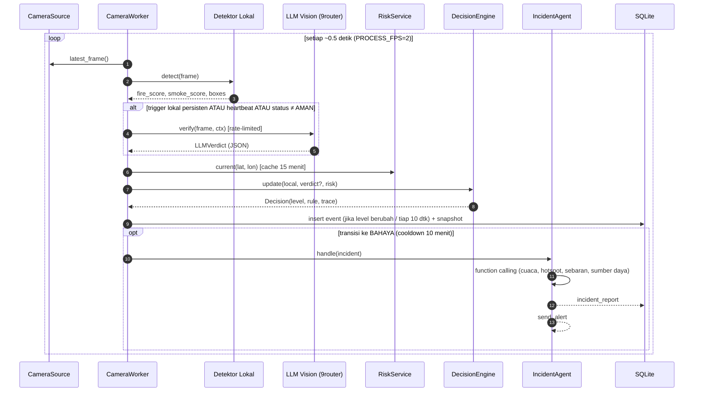
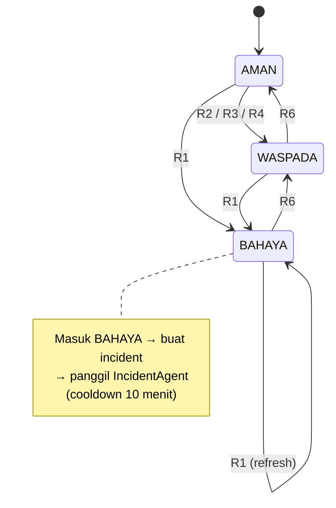

# Arsitektur MataKlabat

Dokumen ini adalah **kontrak teknis** sistem. AI coding agent harus mengikuti nama modul, skema data, dan aturan keputusan di sini. Kalau perlu menyimpang, catat alasannya di bagian *Decision Log* (§12).

---

## 1. Prinsip Desain

1. **Murah dulu, mahal belakangan.** Detektor lokal berjalan di setiap frame. LLM hanya dipanggil saat ada sinyal atau heartbeat.
2. **Tidak ada keputusan dari satu bukti.** BAHAYA hanya diputuskan jika bukti lokal, verifikasi LLM, dan persistensi sejalan.
3. **Setiap keputusan bisa dijelaskan.** Semua transisi status menyimpan *decision trace*.
4. **Degradasi anggun.** Tanpa internet atau API key, sistem tetap berjalan dengan detektor lokal (status maksimal WASPADA, ditandai `llm_unavailable`).
5. **Dua proses, satu database.** `monitor` menulis ke SQLite dan snapshot JPEG, `dashboard` hanya membaca. Dashboard yang crash tidak menghentikan pemantauan.

---

## 2. Komponen

| Modul | Tanggung jawab | Input → Output |
|---|---|---|
| `config.py` | Memuat `.env`, `cameras.yaml`, `resources.yaml` menjadi dataclass `Settings` | file → `Settings` |
| `camera.py` | `CameraSource`: buka webcam (int), file video (loop), atau URL RTSP. Thread pembaca menyimpan frame terbaru | source → `Frame(camera_id, ts, image)` |
| `detector.py` | Tahap 1. `ColorMotionDetector` (default), `YoloDetector` (opsional, jika `YOLO_WEIGHTS` diisi) | `Frame` → `LocalDetection` |
| `prompts.py` | Prompt `v1` (polos) dan `v2` (sadar lookalike + konteks Klabat) | – |
| `vision_llm.py` | Tahap 2. Kirim frame (JPEG ≤ 1024 px) + konteks ke LLM vision via 9router (OpenAI-compatible), paksa output JSON sesuai skema §5 | `Frame`, ctx → `LLMVerdict` |
| `risk.py` | Ambil cuaca dari Open-Meteo (cache 15 menit), hitung Fire Risk Index | lat, lon → `RiskSnapshot` |
| `decision.py` | `DecisionEngine` per kamera: fusi bukti + state machine §6 | bukti → `Decision` (+ trace) |
| `tools.py` | Fungsi-fungsi tool agent §7 | – |
| `agent.py` | `IncidentAgent`: loop tool calling (OpenAI-compatible, via 9router), maks 6 langkah | `Incident` → `IncidentReport` |
| `notifier.py` | `ConsoleNotifier`, `TelegramNotifier` | pesan → terkirim |
| `storage.py` | SQLite (WAL mode): tabel §9 | – |
| `pipeline.py` | Orkestrasi: satu `CameraWorker` (thread) per kamera | – |
| `__main__.py` | CLI `run`, `check` | – |
| `app.py` | Dashboard Streamlit, read-only | DB + snapshot → UI |
| `scripts/evaluate.py` | Evaluasi offline pada test set | folder gambar → metrics |

---

## 3. Alur Data



---

## 4. Tahap 1: Detektor Lokal

### 4.1 `ColorMotionDetector` (wajib, tanpa model)

Langkah per frame (resize lebar 640 px):

1. **Mask api (HSV):** `H ∈ [0, 35]`, `S ≥ 120`, `V ≥ 180` (OpenCV: H 0–179). Tambah aturan RGB: `R > G > B` dan `R ≥ 190`.
2. **Mask asap (HSV):** saturasi rendah `S ≤ 60`, `V ∈ [90, 220]` (abu-abu muda hingga sedang).
3. **Mask gerak:** `absdiff` frame t dan t-1 (grayscale, blur 5×5), threshold 20, lalu dilate. Api berkedip dan asap bergulung, sedangkan benda diam berwarna oranye tidak bergerak.
4. `fire_score = clip(area(mask_api ∧ gerak) / area_frame × FIRE_GAIN, 0, 1)` dengan `FIRE_GAIN = 25`
5. `smoke_score = clip(area(mask_asap ∧ gerak) / area_frame × SMOKE_GAIN, 0, 1)` dengan `SMOKE_GAIN = 8`
6. `boxes`: kontur terbesar (maks 5) dari mask gabungan, area ≥ 0,2% frame.

> Kabut juga abu-abu dan bergerak pelan. Karena itu `smoke_score` sengaja dibuat sensitif lalu diserahkan ke Tahap 2. Ini sumber false positive yang **diharapkan** dan dianalisis di §8.

### 4.2 `YoloDetector` (opsional)

Jika `YOLO_WEIGHTS` berisi path ke model fire/smoke (misalnya hasil training di dataset D-Fire), pakai `ultralytics`. `fire_score` dan `smoke_score` diambil dari confidence maksimum per kelas. Interface-nya **identik** dengan `ColorMotionDetector`.

### 4.3 Trigger ke Tahap 2

Panggil LLM jika salah satu terpenuhi, **dan** rate limit global (`LLM_MIN_INTERVAL_S`) mengizinkan:

| Kode | Kondisi |
|---|---|
| T1 | `fire_score ≥ 0.15` atau `smoke_score ≥ 0.20` pada ≥ 3 dari 5 frame terakhir |
| T2 | Status kamera saat ini WASPADA/BAHAYA. Cek ulang tiap `RECHECK_S = 15` detik |
| T3 | Heartbeat: `HEARTBEAT_S` detik sejak cek LLM terakhir (untuk melihat **potensi**: api unggun, orang membakar, vegetasi kering) |

Antrean LLM bersifat global (satu `threading.Lock` + timestamp). Prioritasnya T2 > T1 > T3.

---

## 5. Tahap 2: Verifikasi LLM Vision (via 9router)

### 5.1 Kontrak output (JSON, wajib)

Gunakan `chat.completions` dengan `response_format={"type": "json_schema", ...}` (SDK `openai` ke `LLM_BASE_URL`). Kontrak yang sama juga ditulis di system message, karena tidak semua provider di belakang 9router mendukung `response_format`; jika endpoint menolaknya (HTTP 400), panggil ulang tanpa `response_format`.

```json
{
  "fire_visible": false,
  "smoke_visible": true,
  "hazard_type": "smoke",
  "lookalike": "none",
  "confidence": 0.82,
  "severity": "medium",
  "risk_factors": ["dry_vegetation"],
  "evidence": ["kolom asap abu-abu naik dari lereng kiri", "pangkal asap menyatu dengan vegetasi"],
  "reasoning": "Asap berbentuk kolom yang naik dan bergulung dari satu titik di permukaan tanah, berbeda dengan kabut yang menyebar merata.",
  "recommended_action": "Verifikasi lapangan ke sektor barat laut kamera."
}
```

| Field | Tipe | Nilai yang diizinkan |
|---|---|---|
| `fire_visible`, `smoke_visible` | bool | |
| `hazard_type` | enum | `none`, `smoke`, `flame`, `smoke_and_flame`, `haze`, `uncertain` |
| `lookalike` | enum | `none`, `fog_cloud`, `sunset_glare`, `artificial_light`, `dust`, `steam`, `other` |
| `confidence` | float 0–1 | keyakinan model terhadap `hazard_type` |
| `severity` | enum | `none`, `low`, `medium`, `high` |
| `risk_factors` | list enum | `dry_vegetation`, `campfire`, `people_burning`, `trash_burning`, `strong_wind_signs`, `none` |
| `evidence` | list str | maks 4, Bahasa Indonesia |
| `reasoning` | str | ≤ 60 kata, Bahasa Indonesia |
| `recommended_action` | str | ≤ 25 kata |

Jika parsing gagal: retry 1x. Jika masih gagal, `LLMVerdict.error = "parse_failed"`, dan Decision Engine memperlakukannya sebagai *tidak ada verdict*.

### 5.2 Prompt

Dua versi disimpan di `prompts.py` untuk **eksperimen prompt** (bonus rubrik).

**`v1`, prompt dasar:**
```
Lihat gambar ini. Apakah ada api atau asap kebakaran? Jawab dalam JSON sesuai skema.
```

**`v2`, prompt kontekstual (default):**
```
Kamu adalah analis pemantau kebakaran hutan untuk kawasan Gunung Klabat, Minahasa Utara.
Gambar berasal dari kamera "{camera_name}" yang menghadap {facing_desc}.
Waktu lokal: {local_time}. Cuaca: suhu {temp}°C, kelembapan {rh}%, angin {wind} km/j.
Detektor lokal memberi skor api {fire_score:.2f} dan asap {smoke_score:.2f} (sensitif, sering salah).

Tugas:
1. Tentukan apakah ada API atau ASAP KEBAKARAN yang nyata.
2. Waspadai LOOKALIKE yang umum di Klabat: kabut/awan yang menyelimuti lereng (menyebar rata,
   putih, tanpa titik sumber), cahaya matahari terbit/terbenam, lampu kendaraan/rumah, debu, uap.
   Asap kebakaran biasanya: berbentuk kolom/gumpalan, bersumber dari satu titik di permukaan,
   berwarna abu-abu hingga coklat/kehitaman, bergerak naik.
3. Catat FAKTOR RISIKO yang terlihat walau belum ada api (api unggun, orang membakar, sampah dibakar,
   vegetasi sangat kering).
4. Jika ragu, gunakan hazard_type "uncertain" dan confidence rendah. Jangan menebak.
Jawab HANYA dalam JSON sesuai skema. reasoning dan evidence dalam Bahasa Indonesia.
```

### 5.3 Konsistensi

`scripts/evaluate.py --repeat 3` mengirim gambar yang sama 3x untuk mengukur **konsistensi** keputusan LLM. Hasilnya: persentase gambar dengan label identik, serta deviasi standar confidence.

---

## 6. Decision Engine

### 6.1 Fire Risk Index (FRI)

Dari Open-Meteo (`current`: `temperature_2m`, `relative_humidity_2m`, `wind_speed_10m`, `wind_direction_10m`; `daily`: `precipitation_sum` 14 hari terakhir via `past_days=14`):

```
dryness = clip((70 - RH) / 50, 0, 1)
heat    = clip((T - 24) / 12, 0, 1)
wind    = clip(W_kmh / 30, 0, 1)
drought = clip(hari_tanpa_hujan(≥1 mm) / 14, 0, 1)

FRI = round(100 × (0.35·dryness + 0.15·heat + 0.25·wind + 0.25·drought))
Kategori: < 30 RENDAH · 30–59 SEDANG · ≥ 60 TINGGI
```

> FRI adalah **heuristik** yang dirancang tim untuk tugas ini. Bobotnya dipilih karena kelembapan rendah dan kemarau panjang adalah faktor dominan. Jelaskan ini di laporan, jangan diklaim sebagai indeks resmi.

### 6.2 Ambang

| Konstanta | Nilai | Keterangan |
|---|---|---|
| `CONF_DANGER` | 0.70 | confidence minimum LLM untuk BAHAYA |
| `CONF_DANGER_HIGH_RISK` | 0.60 | dipakai jika FRI ≥ 60 |
| `CONF_WARN` | 0.40 | |
| `CONFIRM_WINDOW` | 3 | jumlah verdict LLM terakhir yang dilihat |
| `CONFIRM_MIN` | 2 | minimal verdict positif di window (atau 1 jika confidence ≥ 0.90) |
| `CLEAR_STEPS` | 4 | verdict/frame bersih berturut-turut untuk turun 1 level |
| `AGENT_COOLDOWN_S` | 600 | agent tidak dipanggil ulang untuk kamera yang sama |

### 6.3 Aturan (dievaluasi berurutan, aturan pertama yang cocok menang)

| Rule | Kondisi | Hasil |
|---|---|---|
| **R1** | Verdict positif (`fire_visible ∨ smoke_visible`), `lookalike = none`, `confidence ≥ ambang_bahaya`, dan terkonfirmasi `CONFIRM_MIN` dari `CONFIRM_WINDOW` | **BAHAYA** |
| **R2** | Verdict positif dengan `confidence ∈ [CONF_WARN, ambang_bahaya)`, ATAU `hazard_type = uncertain` sementara trigger lokal T1 aktif | **WASPADA** |
| **R3** | `risk_factors` mengandung `campfire`/`people_burning`/`trash_burning` | **WASPADA** (sub-status `POTENSI`) |
| **R4** | Trigger lokal T1 aktif tapi LLM tidak tersedia (`llm_unavailable`) | **WASPADA** (`unverified`) |
| **R5** | Verdict positif tapi `lookalike ≠ none` | tetap di level sekarang, catat `rejected_lookalike` |
| **R6** | Tidak ada bukti selama `CLEAR_STEPS` | turun 1 level (BAHAYA → WASPADA → AMAN) |
| **R0** | Default | **AMAN** |

`ambang_bahaya = CONF_DANGER_HIGH_RISK if FRI ≥ 60 else CONF_DANGER`

### 6.4 State machine



### 6.5 Decision trace (XAI)

Setiap `Decision` menyimpan `trace` (JSON):

```json
{
  "rule": "R1",
  "level_from": "WASPADA",
  "level_to": "BAHAYA",
  "inputs": {
    "local": {"fire_score": 0.31, "smoke_score": 0.44, "t1_hits": "4/5"},
    "llm": {"hazard_type": "smoke", "confidence": 0.86, "lookalike": "none", "prompt": "v2"},
    "confirm": "2/3",
    "risk": {"fri": 72, "category": "TINGGI", "threshold_used": 0.60}
  },
  "explanation": "BAHAYA karena LLM melihat asap (0.86 ≥ 0.60, ambang diturunkan karena FRI 72), bukan lookalike, terkonfirmasi 2 dari 3 cek."
}
```

`explanation` dibuat secara **deterministik** dari template, bukan dari LLM, supaya selalu jujur terhadap aturan yang benar-benar terpicu.

---

## 7. AI Agent Tindak Lanjut

### 7.1 Tujuan

Saat sebuah kamera masuk BAHAYA, `IncidentAgent` menyusun **laporan insiden yang bisa langsung ditindaklanjuti**. Agent memakai tool calling (format OpenAI) lewat 9router, maksimal 6 langkah tool, dengan timeout total 60 detik.

### 7.2 Tools

| Tool | Parameter | Kembalian | Sumber |
|---|---|---|---|
| `get_weather` | `lat, lon` | suhu, RH, angin (km/j, arah°), FRI | Open-Meteo |
| `get_satellite_hotspots` | `lat, lon, radius_km=10` | daftar hotspot 24 jam (lat, lon, confidence, waktu) atau `{"status":"unavailable"}` | NASA FIRMS (opsional) |
| `estimate_spread` | `camera_id, wind_dir_deg, wind_kmh` | arah sebaran (mata angin), desa dari `resources.yaml` yang berada dalam sektor ±45° searah angin dan ≤ 8 km, beserta jaraknya | lokal (haversine + bearing) |
| `find_nearest_resources` | `lat, lon, kind?` | posko/damkar/puskesmas terdekat dari `resources.yaml` | lokal |
| `get_recent_events` | `camera_id, minutes=30` | ringkasan event kamera itu | SQLite |
| `send_alert` | `level, title, message` | status kirim | Console selalu. Telegram jika `AUTO_SEND_ALERT=true` |

> Catatan arah: angin dari arah X° mendorong api **ke** arah (X+180)° mod 360. `estimate_spread` wajib memakai konversi ini, dan unit test harus mengujinya.

### 7.3 System prompt agent (ringkas)

```
Kamu adalah agen tanggap darurat karhutla Gunung Klabat. Sebuah kamera mendeteksi BAHAYA.
Gunakan tools untuk: (1) cek cuaca, (2) cek hotspot satelit, (3) perkirakan arah sebaran dan desa
terancam, (4) cari sumber daya terdekat. Lalu tulis LAPORAN INSIDEN dalam Bahasa Indonesia dengan
bagian: Ringkasan, Bukti, Kondisi Cuaca & Risiko, Arah Sebaran & Desa Terancam, Rekomendasi Tindakan
(urut prioritas, maks 5), Pihak yang Dihubungi. Terakhir panggil send_alert dengan ringkasan ≤ 600
karakter. Jangan mengarang data yang tidak dikembalikan tools; tulis "tidak tersedia" jika kosong.
```

### 7.4 Human-in-the-loop

- Default `AUTO_SEND_ALERT=false`: laporan hanya muncul di dashboard dan console. Operator menekan tombol **"Kirim ke Telegram"** di dashboard.
- Laporan agent selalu menyertakan label *"Dihasilkan AI. Verifikasi lapangan diperlukan."*

---

## 8. Analisis Kegagalan yang Diharapkan

Kasus-kasus ini **wajib diuji** di `scripts/evaluate.py` dan dibahas di laporan. Ini padanan analisis kegagalan di rubrik.

| # | Kasus | Jenis | Mengapa terjadi | Mitigasi di sistem |
|---|---|---|---|---|
| F1 | **Kabut/awan Klabat dikira asap** | False positive | Abu-abu, bergerak, menutupi lereng. Mirip asap bagi detektor warna dan kadang bagi LLM | Prompt v2 menjelaskan beda kabut dan asap. Field `lookalike`. Aturan R5. Konfirmasi 2/3 |
| F2 | **Cahaya senja/lampu dikira api** | False positive | Warna oranye-merah dengan saturasi tinggi | Mask gerak (senja tidak berkedip). Konteks waktu lokal di prompt. Kategori `sunset_glare`/`artificial_light` |
| F3 | **Asap tipis/jauh atau malam hari tidak terdeteksi** | False negative | Area piksel kecil, kontras rendah, webcam gelap | Heartbeat T3. FRI menurunkan ambang. Diakui sebagai keterbatasan |
| F4 | **Inkonsistensi LLM** | Ketidakstabilan | Gambar sama → label/confidence berbeda | Konfirmasi multi-verdict. Ukur dengan `--repeat 3` |
| F5 | **Prompt mempengaruhi keputusan** | Sensitivitas prompt | v1 cenderung "ya ada asap" pada kabut | Bandingkan v1 dan v2 di evaluasi |

---

## 9. Skema Database (SQLite, `data/runtime/events.db`)

```sql
CREATE TABLE IF NOT EXISTS events (
  id INTEGER PRIMARY KEY AUTOINCREMENT,
  ts TEXT NOT NULL,                 -- ISO8601, zona Asia/Makassar
  camera_id TEXT NOT NULL,
  level TEXT NOT NULL,              -- AMAN | WASPADA | BAHAYA
  sub_status TEXT,                  -- POTENSI | unverified | rejected_lookalike | NULL
  fire_score REAL, smoke_score REAL,
  llm_json TEXT,                    -- LLMVerdict mentah (nullable)
  fri INTEGER,
  rule TEXT,
  trace_json TEXT NOT NULL,
  snapshot_path TEXT
);
CREATE INDEX IF NOT EXISTS idx_events_cam_ts ON events(camera_id, ts);

CREATE TABLE IF NOT EXISTS incidents (
  id INTEGER PRIMARY KEY AUTOINCREMENT,
  opened_ts TEXT NOT NULL,
  closed_ts TEXT,
  camera_id TEXT NOT NULL,
  peak_level TEXT NOT NULL,
  trigger_event_id INTEGER REFERENCES events(id),
  report_md TEXT,                   -- laporan agent (markdown)
  agent_steps_json TEXT,            -- jejak tool call agent
  alert_sent INTEGER DEFAULT 0
);

CREATE TABLE IF NOT EXISTS camera_status (   -- 1 baris per kamera, di-upsert
  camera_id TEXT PRIMARY KEY,
  ts TEXT NOT NULL,
  level TEXT NOT NULL,
  fri INTEGER,
  last_snapshot TEXT,
  last_reasoning TEXT,
  online INTEGER NOT NULL
);
```

Penulisan `events`: saat level berubah, tiap kali ada verdict LLM, dan minimal 1x per 10 detik per kamera (heartbeat ringan). Snapshot disimpan ke `data/runtime/snapshots/{camera_id}/latest.jpg` (ditimpa), dan juga ke file berstempel waktu saat level ≥ WASPADA.

---

## 10. Dashboard (`app.py`)

Auto-refresh tiap 1 detik (`st.fragment(run_every=1)`), read-only dari DB dan snapshot.

```
┌──────────────────────────────────────────────────────────────────────┐
│ 🔥👁️ MataKlabat   Status kawasan: ● WASPADA   FRI 64 (TINGGI)  🕒 14:32 │
├───────────────────────────────┬──────────────────────────────────────┤
│  Grid kamera 2×2              │   🗺️ Peta Gunung Klabat (folium)      │
│  [CAM-01 ● BAHAYA ] [CAM-02 ●]│   marker per kamera (hijau/kuning/    │
│  [CAM-03 ●        ] [CAM-04 ●]│   merah) + panah arah angin +         │
│  (snapshot terbaru + bbox)    │   hotspot FIRMS (jika ada)            │
├───────────────────────────────┴──────────────────────────────────────┤
│ 🧠 Mengapa? (kamera terpilih): decision trace + reasoning LLM + bukti │
├──────────────────────────────────────────────────────────────────────┤
│ 🚨 Insiden: laporan agent (markdown) · [Kirim ke Telegram]            │
├──────────────────────────────────────────────────────────────────────┤
│ 📈 Riwayat: fire/smoke score & level per kamera (plotly), tabel event │
└──────────────────────────────────────────────────────────────────────┘
```

Warna status: AMAN `#2E7D32`, WASPADA `#F9A825`, BAHAYA `#C62828`, offline `#757575`.

---

## 11. Konfigurasi `resources.yaml`

```yaml
villages:            # untuk estimate_spread (koordinat PERKIRAAN, verifikasi!)
  - {name: "Airmadidi", lat: 1.4196, lon: 124.9822}
  - {name: "Tatelu",    lat: 1.4930, lon: 124.9770}
  - {name: "Matungkas", lat: 1.4800, lon: 124.9400}
  - {name: "Laikit",    lat: 1.4700, lon: 124.9600}
  - {name: "Klabat",    lat: 1.4300, lon: 124.9950}
resources:
  - {name: "Posko BPBD Minahasa Utara", kind: posko, lat: 1.4190, lon: 124.9830, contact: "ISI_SENDIRI"}
  - {name: "Damkar Minahasa Utara",     kind: damkar, lat: 1.4180, lon: 124.9800, contact: "ISI_SENDIRI"}
reference_points:
  - {name: "Puncak Klabat", lat: 1.4667, lon: 125.0333}
```

> Jangan mengisi nomor kontak yang tidak diverifikasi. Biarkan `ISI_SENDIRI` sampai tim mengonfirmasi.

---

## 12. Decision Log

| Tanggal | Keputusan | Alasan |
|---|---|---|
| 2026-10-26 | Python + Streamlit | Rubrik meminta script `.py`. Streamlit adalah dashboard tercepat untuk build 1 hari |
| 2026-10-26 | Deteksi 2 tahap (lokal → LLM) | Menghemat kuota Gemini gratis. LLM memberi konteks dan penjelasan |
| 2026-10-26 | Monitor dan dashboard dipisah, komunikasi lewat SQLite | Robust, sederhana, tidak perlu message broker |
| 2026-10-26 | `explanation` deterministik dari template | XAI harus jujur terhadap aturan yang benar-benar terpicu |
| 2026-10-26 | `pyproject.toml` (src layout) + `pip install -e .` | Supaya `python -m mataklabat` jalan dari mana saja tanpa mengatur `PYTHONPATH`. Dependensi tetap dibaca dari `requirements.txt` |
| 2026-10-26 | Nama env konstanta = nama field `Settings` huruf besar; trigger §4.3 memakai `FIRE_TRIGGER`, `SMOKE_TRIGGER`, `TRIGGER_WINDOW`, `TRIGGER_MIN_HITS`, dan `CONF_SINGLE_CONFIRM` (0.90) untuk konfirmasi 1 verdict | Dokumen belum memberi nama untuk konstanta ini. Satu aturan penamaan untuk semua override |
| 2026-10-26 | Nilai env berawalan `isi_` dianggap kosong | `.env` yang disalin mentah dari `.env.example` tidak boleh dianggap API key sungguhan |
| 2026-10-26 | `boxes` diambil dari `connectedComponentsWithStats`, bukan `findContours`; luas = jumlah piksel komponen; mask gerak di-dilate 5×5 sebanyak 2 iterasi | `findContours` + `contourArea` turun ke 12 FPS pada frame bising (noise sensor malam). Connected components tetap ≥ 30 FPS di kasus terburuk |
| 2026-10-26 | R6 juga dipakai untuk langkah "menahan level": selama level > AMAN dan tidak ada bukti, R6 menghitung langkah bersih (`clear: n/4` di trace) dan baru menurunkan level saat hitungan penuh. Bukti baru mereset hitungan. Rule bukti (R4, nanti R1–R3) tidak pernah menurunkan level | §6.3 tidak menyebut rule untuk langkah tunggu; memakai R6 menghindari rule baru dan tetap jujur di trace |
| 2026-10-26 | Satu langkah = satu frame yang diproses (`PROCESS_FPS`). Mode tanpa LLM: langkah bersih = T1 tidak aktif | Dengan PROCESS_FPS=2 dan CLEAR_STEPS=4, turun 1 level butuh ±2 dtk setelah T1 padam |
| 2026-10-26 | `run --duration DETIK` | Untuk uji stabilitas Checkpoint A dan verifikasi otomatis tanpa Ctrl+C |
| 2026-10-26 | **LLM lewat 9router (endpoint OpenAI-compatible), bukan Gemini/`google-genai`.** Env `LLM_BASE_URL`, `LLM_API_KEY`, `LLM_MODEL`; SDK `openai`. Dipakai untuk vision (T5) dan agent (T9). Tidak ada cadangan Gemini langsung | Keputusan pemilik proyek. Satu gateway untuk banyak provider/model; model bisa diganti dari dashboard 9router tanpa ubah kode |
| 2026-10-26 | `llm_enabled` = `LLM_MODEL` terisi (API key opsional, 9router lokal bisa tanpa key). `risk_factors: ["none"]` disimpan sebagai daftar kosong. Confidence 1–100 dianggap persen | Normalisasi jawaban model yang berbeda-beda gaya |
| 2026-10-26 | R2 juga mencakup verdict positif (bukan lookalike) dengan confidence ≥ ambang bahaya yang **belum terkonfirmasi** (misal 0.75 pertama). Verdict positif dengan confidence < `CONF_WARN` dianggap bukan bukti | Tanpa ini verdict 0.75 pertama jatuh ke AMAN, padahal kriteria T6 meminta 0.75 butuh 2/3 (bukan diabaikan) |
| 2026-10-26 | Konfirmasi = jumlah verdict di `CONFIRM_WINDOW` terakhir yang positif, `lookalike=none`, dan confidence ≥ ambang bahaya. Verdict ber-`error` tidak masuk window | Definisi "terkonfirmasi" di §6.3 belum eksplisit; error API/parse bukan bukti apa pun |
| 2026-10-26 | Saat LLM tersedia, R6 hanya menghitung **verdict** bersih (frame di antara verdict tidak dihitung). Frame tanpa info baru mempertahankan rule terakhir dengan penjelasan "Masih berlaku: …". R5 menahan level tanpa mengubah hitungan bersih | Satu verdict positif tidak boleh "terhapus" oleh 4 frame (2 detik) tanpa verdict baru; T2 (cek ulang tiap `RECHECK_S`) menjamin verdict baru datang |
| 2026-10-26 | Trigger: T1 dan T2 per kamera dibatasi `RECHECK_S` sejak panggilan terakhir kamera itu; T3 juga terpicu sekali saat start. Prioritas global lewat `LLMScheduler` (kamera dengan trigger lebih rendah menunggu selama ada kamera lain yang menunggu dengan trigger lebih tinggi) | Mencegah T1 yang terus aktif (misal kabut) memanggil LLM tiap 8 detik; mewujudkan prioritas T2 > T1 > T3 di §4.3 |
| 2026-10-26 | Verdict ber-`error` (selain `rate_limited`) membuat LLM dianggap tidak tersedia sampai panggilan berikutnya berhasil, sehingga R4 berlaku | §1 prinsip degradasi anggun: tanpa LLM sistem tetap bisa WASPADA |
| 2026-10-26 | **v2: FRI heuristik diganti FWI Kanada + kelas FDRS Indonesia** (de Groot dkk. 2006, tabel 1–3: FFMC, DC, ISI). Risiko kawasan = kelas tertinggi dari tiga indikator; FWI ditampilkan sebagai angka pendamping. Ambang BAHAYA turun ke 0.60 saat risiko Tinggi/Sangat Tinggi | Spec v2 §6. FDRS tidak mendefinisikan kelas untuk nilai FWI; agregasi "kelas tertinggi" adalah keputusan tim |
| 2026-10-26 | Rantai FWI dihitung ulang tiap refresh dari data Open-Meteo yang tersedia (hingga 92 hari, mulai dari hari lengkap pertama); tidak ada state FWI yang dipersist | Restart tidak memutus rantai kekeringan dan tidak butuh tabel state. Open-Meteo hanya punya ±70 hari riwayat untuk titik ini |
| 2026-10-26 | Penyesuaian lintang ekuator mengikuti paket R `cffdrs`: DMC day length 9,0 (|lat| ≤ 10), DC factor 1,4 (|lat| ≤ 20) | Klabat 1,47° LU; tabel standar Van Wagner untuk 46° LU tidak cocok |
| 2026-10-26 | Kamera Foto (`mode: foto`): `FolderSource` menerbitkan ulang foto terbaru tiap 1 dtk; detektor warna saja (`use_motion=False`); foto yang belum dicek dihitung sebagai T1 langsung (tanpa menunggu `RECHECK_S`), sekali per foto. Foto demo di `data/demo/**` tidak di-commit | Spec v2 §5.2: demo tanpa kamera lapangan; foto diam tidak punya gerak |
| 2026-10-26 | Skema v2: kolom `events.fri` diganti `risk_level` + `fwi`; `camera_status` ditambah nama, mode, rule, penjelasan, skor, alasan offline; tabel baru `risk_daily`, `risk_current` (1 baris JSON untuk web), `outbox`, `component_health` | Spec v2 §11. DB runtime dibuat ulang (tidak ada data lama yang perlu dimigrasi) |
| 2026-10-26 | Event ditulis saat level berubah, ada verdict, atau ≥ 10 dtk sejak event terakhir; status kamera dan `latest.jpg` diperbarui ≤ 1×/dtk; arsip foto hanya untuk event level ≥ WASPADA. Retensi membiarkan event pemicu insiden | Menjaga DB dan disk tetap kecil tanpa kehilangan bukti insiden |
| 2026-10-26 | `AUTO_SEND_ALERT` default `true`; `false` atau Telegram belum diisi = mode kering (pesan dibuat dan tampil di web dengan status `dry_run`, tidak dikirim) | Spec v2 §8.1 (keputusan pemilik: peringatan otomatis bertingkat) |
| 2026-10-26 | Teks penjelasan (`explanation`) dan log console memakai label UI (Normal / Perlu Dicek / Kebakaran Terdeteksi, "AI" untuk LLM); nilai enum dan kolom DB tetap AMAN/WASPADA/BAHAYA | Konsistensi bahasa dengan web dan Telegram tanpa mengubah kontrak data |
| 2026-10-26 | Ringkasan pagi hanya dikirim dalam 3 jam setelah `MORNING_SUMMARY_AT` dan menunggu data cuaca hingga 15 menit; peringatan risiko naik tidak dikirim untuk nilai pertama setelah instalasi | Mencegah "ringkasan pagi" malam hari saat monitor baru dinyalakan dan peringatan palsu saat start |
| | *(agent menambahkan baris di sini)* | |
