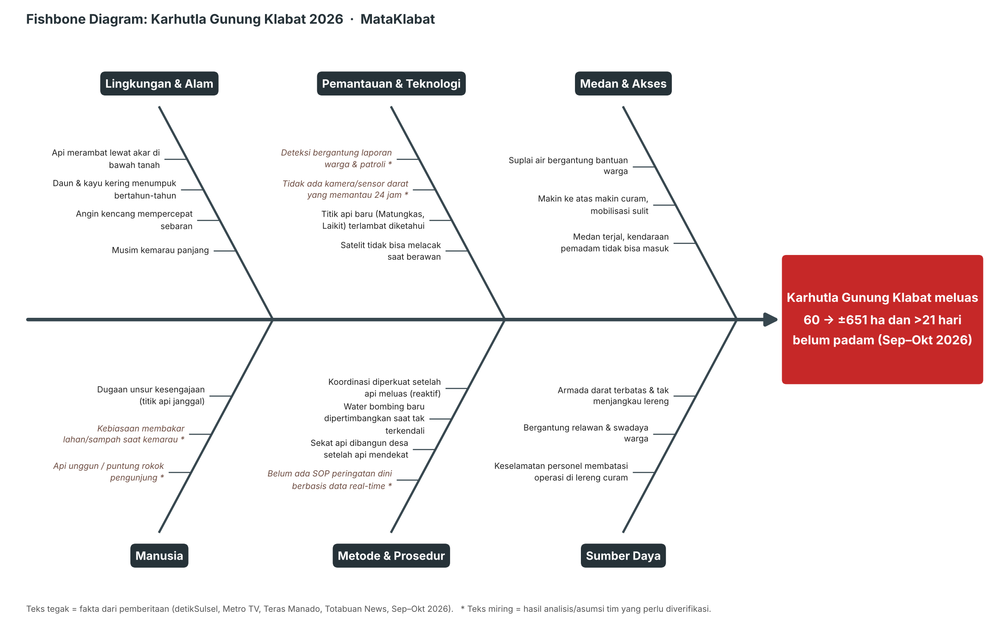

# Root Cause Analysis (RCA): Karhutla Gunung Klabat 2026

> **Metode:** pengumpulan fakta dari pemberitaan, lalu **Fishbone Diagram** (6 kategori) untuk memetakan penyebab, lalu **5 Whys** untuk menelusuri akar masalah, lalu pemisahan akar masalah yang **bisa** dan **tidak bisa** dikendalikan, lalu kaitan ke solusi (MataKlabat) dan rekomendasi institusi.
>
> **Label sumber:** **[S]** = fakta dari pemberitaan (lihat §8). **[A]** = hasil analisis/asumsi tim yang **perlu diverifikasi**, misalnya lewat wawancara BPBD/Dinas Kehutanan.

---

## 1. Pernyataan Masalah

**Karhutla di kaki Gunung Klabat, Minahasa Utara, yang dimulai 19 September 2026, meluas dari 60 ha menjadi ±651 ha (termasuk ±131,59 ha hutan lindung) dan tetap belum padam lebih dari 21 hari.** [S]

| Dimensi | Keterangan |
|---|---|
| **Apa** | Kebakaran hutan dan lahan yang terus meluas dan muncul di titik baru |
| **Di mana** | Kaki Gunung Klabat, berawal di sekitar Monumen Kaki Dian, Kel. Airmadidi. Menyebar ke arah hutan lindung, Matungkas, dan Laikit [S] |
| **Kapan** | 19 September 2026 hingga ≥ 11 Oktober 2026. Status tanggap darurat diperpanjang 8–21 Oktober 2026 [S] |
| **Dampak** | Hutan lindung terbakar. Asap pekat menurunkan kualitas udara Minut, dan warga diimbau memakai masker. Bandara Sam Ratulangi terancam terganggu jarak pandang. Biaya operasi gabungan besar [S] |

---

## 2. Kronologi

| Tanggal | Peristiwa | Sumber |
|---|---|---|
| Sab, 19 Sep 2026 | Kebakaran pertama dilaporkan di sekitar Monumen Kaki Dian, Airmadidi | detikSulsel (29/9) |
| 20–21 Sep 2026 | BNPB: total ±60 ha terbakar, ±10 ha belum padam. Angin kencang mempercepat sebaran. Dikerahkan 3 mobil BPBD, 4 Damkar Minut, 1 Damkar TNI | Metro TV |
| Akhir Sep 2026 | Sempat diberitakan "berhasil dipadamkan", namun api kembali meluas | Barometer (judul), detikSulsel |
| Sel, 29 Sep 2026 | ±300 ha, hari ke-11. Ditemukan **titik api baru yang janggal**, dan dugaan kesengajaan diselidiki. Medan terjal, kendaraan tidak bisa masuk. Warga membantu menyediakan air | detikSulsel |
| Rab, 1 Okt 2026 | Api bergerak ke **hutan lindung**. Bupati memperkuat koordinasi. **Water bombing mulai dipertimbangkan**. Asap berpotensi menutup Bandara Sam Ratulangi | Teras Manado, Totabuan News |
| 3 Okt 2026 | Estimasi Dinas Kehutanan Sulut: **±651 ha** (131,59 ha hutan lindung + 519,93 ha lahan lain) | detikSulsel (11/10) |
| Jum, 9 Okt 2026 | Hari ke-21. Bupati menyebut "mendekati 400 ha". Kadishut: **"kalau berawan alat pemantau tak bisa melacak"**. Tanggap darurat diperpanjang 8–21 Okt | detikSulsel |
| Min, 11 Okt 2026 | Hari ke-23. Titik api baru di **Matungkas & Laikit**. Api **menjalar lewat akar di bawah tanah** | detikSulsel |
| ±13 Okt 2026 | Asap menyelimuti Minut, dan DLH mengimbau warga memakai masker | Manado Post (judul) |

> Catatan: angka luas berbeda antar sumber (≈400 ha menurut Bupati pada 9/10, dan ±651 ha menurut estimasi Dishut per 3/10) karena perbedaan waktu dan metode. Laporan ini memakai angka Dishut sebagai estimasi tertinggi dan menyebut keduanya.

---

## 3. Fishbone Diagram

*(Sumber gambar dapat dibuat ulang dengan `python docs/assets/make_fishbone.py`. Versi vektor: `assets/fishbone.svg`.)*

| Kategori | Penyebab | Label |
|---|---|---|
| **Lingkungan & Alam** | Musim kemarau | S |
| | Angin kencang mempercepat sebaran | S |
| | Daun dan kayu kering menumpuk bertahun-tahun (bahan bakar) | S |
| | Api merambat lewat akar di bawah tanah, lalu muncul lagi di tempat lain | S |
| **Pemantauan & Teknologi** | Satelit/alat pemantau tidak bisa melacak saat berawan | S |
| | Titik api baru (Matungkas, Laikit) terlambat diketahui | S |
| | Tidak ada kamera/sensor darat yang memantau 24 jam | A |
| | Deteksi bergantung pada laporan warga dan patroli | A |
| **Medan & Akses** | Medan terjal, kendaraan pemadam tidak bisa masuk | S |
| | Makin ke atas makin curam, mobilisasi sulit | S |
| | Suplai air bergantung bantuan warga | S |
| **Manusia** | Dugaan unsur kesengajaan (titik api baru yang janggal) | S |
| | Kebiasaan membakar lahan/sampah saat kemarau | A |
| | Api unggun atau puntung rokok pengunjung | A |
| **Metode & Prosedur** | Koordinasi diperkuat setelah api meluas (reaktif) | S |
| | Water bombing baru dipertimbangkan saat api tak terkendali | S |
| | Sekat api dibangun desa setelah api mendekat | S |
| | Belum ada SOP peringatan dini berbasis data real-time | A |
| **Sumber Daya** | Armada darat terbatas dan tidak menjangkau lereng | S |
| | Bergantung pada relawan dan swadaya warga | S |
| | Keselamatan personel membatasi operasi di lereng curam | S |

---

## 4. 5 Whys

**Masalah:** Karhutla meluas hingga ±651 ha dan tidak padam selama lebih dari 21 hari.

| # | Mengapa? | Jawaban |
|---|---|---|
| 1 | Mengapa api meluas sangat besar? | Api menyebar lebih cepat daripada kemampuan tim memadamkan, terutama di lereng terjal yang tidak terjangkau kendaraan, dan terus muncul **titik api baru** [S] |
| 2 | Mengapa titik api baru terus lolos dan membesar? | Titik api baru (dari akar bawah tanah, loncatan bara karena angin, atau dugaan kesengajaan) **tidak segera diketahui**, sehingga baru ditangani setelah membesar [S/A] |
| 3 | Mengapa tidak segera diketahui? | Pemantauan bergantung pada **satelit** (buta saat berawan, resolusi waktu terbatas), **patroli**, dan **laporan warga**. Tidak ada yang mengawasi lereng secara **kontinu** [S/A] |
| 4 | Mengapa tidak ada pemantauan kontinu? | Kawasan Klabat belum memiliki **infrastruktur deteksi dini darat** (kamera/sensor di titik pandang) yang terhubung ke posko [A] |
| 5 | Mengapa infrastruktur itu belum ada? | Penanganan karhutla selama ini bersifat **reaktif**: sumber daya dikerahkan setelah kebakaran terjadi. Sistem pemantauan berbiaya tinggi dan belum tersedia solusi yang murah dan mudah dipasang di tingkat kabupaten/desa [A] |

---

## 5. Akar Masalah

### 5.1 Akar masalah utama (dapat dikendalikan)

> **Tidak adanya pemantauan darat yang kontinu dan terintegrasi dengan posko, sehingga api, terutama titik api baru, diketahui dan ditangani setelah sudah membesar.**

### 5.2 Faktor yang tidak dapat dikendalikan (harus diantisipasi)

Kemarau, angin kencang, medan curam, dan karakter api bawah tanah. Faktor-faktor ini **tidak bisa dihilangkan**, tetapi dampaknya bisa diperkecil jika **deteksi lebih cepat** dan **arah sebaran diketahui lebih awal**.

### 5.3 Akar masalah lain (di luar lingkup sistem)

- **Dugaan kesengajaan pembakaran**: ranah penegakan hukum dan patroli. Sistem hanya membantu sebagai **bukti visual** (snapshot berstempel waktu).
- **Keterbatasan armada dan akses**: butuh anggaran (jalur pemadaman, embung/tandon air, alat pemadam lereng).

---

## 6. Dari Akar Masalah ke Solusi

| Penyebab (Fishbone) | Fitur MataKlabat yang menjawab |
|---|---|
| Satelit buta saat berawan | Kamera darat di bawah awan dan sudah bekerja sebelum asap tebal |
| Titik api baru terlambat diketahui | Pemantauan kontinu multi-kamera. Kebakaran Terdeteksi ±35 detik setelah gambar masuk (gladi 27 Okt 2026) |
| Deteksi bergantung laporan warga | Deteksi otomatis + notifikasi Telegram ke posko dan Hukum Tua |
| Angin kencang mempercepat sebaran | Agent menghitung **arah sebaran** dari angin real-time dan menyebut **desa terancam** |
| Koordinasi reaktif / belum ada SOP | Laporan insiden terstruktur (bukti, risiko, rekomendasi, pihak yang dihubungi) sebagai bahan SOP |
| Kemarau dan bahan bakar kering | **Risiko Kebakaran Kawasan** harian (FWI + kelas FDRS Indonesia), sehingga ambang deteksi lebih sensitif saat risiko Tinggi/Sangat Tinggi |
| Api unggun / pembakaran (A) | Status **Perlu Dicek (potensi)** jika AI melihat api kecil terkendali (api unggun, pembakaran sampah/daun) sebelum menjadi kebakaran |
| Dugaan kesengajaan | Snapshot berstempel waktu dan log event sebagai jejak bukti |
| Medan, armada, air | ❌ **Tidak diselesaikan** sistem. Masuk rekomendasi institusi §7 |

---

## 7. Rekomendasi untuk Institusi

| Prioritas | Untuk | Rekomendasi | Dasar |
|---|---|---|---|
| 1 | **BPBD Minahasa Utara** | Pasang 3–4 kamera pantau di titik pandang tinggi (sekitar Kaki Dian, jalur pendakian, Tatelu, Matungkas–Laikit) yang terhubung ke posko. Jadikan peringatan otomatis sebagai pemicu SOP respons awal ≤ 30 menit | Akar masalah §5.1 |
| 2 | **Dinas Kehutanan Sulut & Manggala Agni** | Gabungkan data satelit (FIRMS/SiPongi) dengan kamera darat. Satelit untuk cakupan luas, kamera untuk verifikasi cepat saat berawan | Kutipan Kadishut soal awan |
| 3 | **Pemerintah Desa** (Tatelu, Matungkas, Laikit, Airmadidi) | Bangun sekat api **sebelum** musim kemarau berdasarkan Risiko Kebakaran Kawasan, bukan setelah api mendekat. Bentuk grup Telegram/WA peringatan desa | Sekat api reaktif [S] |
| 4 | **Pengelola jalur pendakian Klabat** | Larangan api unggun saat Risiko Kawasan Tinggi/Sangat Tinggi, ditegakkan dengan pengumuman di pos dan pemantauan kamera | Faktor risiko manusia (A) |
| 5 | **Pemkab Minut** | Anggarkan tandon air dan jalur pemadaman di lereng bawah, serta jadwalkan pembersihan bahan bakar kering | Kendala medan dan air [S] |
| 6 | **UNKLAB / FILKOM** | Lanjutkan prototipe sebagai proyek riset/pengabdian: uji lapangan 1 kamera di kampus yang menghadap Klabat | Keberlanjutan |

---

## 8. Sumber

1. detikSulsel, 29/9/2026: [Karhutla di Kaki Gunung Klabat Sudah 11 Hari Belum Padam](https://www.detik.com/sulsel/berita/d-8684921/karhutla-di-kaki-gunung-klabat-sudah-11-hari-belum-padam)
2. detikSulsel, 9/10/2026: [Karhutla di Gunung Klabat 21 Hari Belum Padam, Ini Kendalanya](https://www.detik.com/sulsel/berita/d-8699946/karhutla-di-gunung-klabat-21-hari-belum-padam-ini-kendalanya)
3. detikSulsel, 11/10/2026: [Karhutla di Gunung Klabat Meluas, 651 Hektare Lahan Hangus](https://www.detik.com/sulsel/berita/d-8702328/karhutla-di-gunung-klabat-meluas-651-hektare-lahan-hangus)
4. Metro TV News, 21/9/2026: [BNPB: 60 Hektare Lahan di Kaki Gunung Klabat Terbakar](https://www.metrotvnews.com/read/KvJCJZAA-bnpb-60-hektare-lahan-di-kaki-gunung-klabat-terbakar)
5. Teras Manado, 1/10/2026: [Karhutla Minut Bergerak ke Hutan Lindung Gunung Klabat](https://terasmanado.com/2026/10/01/karhutla-minut-bergerak-ke-hutan-lindung-gunung-klabat-joune-ganda-perkuat-koordinasi-penanganan/)
6. Totabuan News, 1/10/2026: [Karhutla Rambah Hutan Lindung Gunung Klabat](https://totabuan.news/daerah/minut/karhutla-rambah-hutan-lindung-gunung-klabat-bupati-joune-ganda-waspadai-meluasnya-ancaman-ekologi-dan-ekonomi/)
7. Barometer: [Kebakaran di Kaki Gunung Klabat Capai 60 Hektar, Sudah Berhasil Dipadamkan](https://barometer.co.id/2026/09/kebakaran-di-kaki-gunung-klabat-capai-60-hektar-sudah-berhasil-dipadamkan/) (hanya judul yang dirujuk)
8. Manado Post: [Asap Karhutla Gunung Klabat Selimuti Minut, DLH Imbau Warga Gunakan Masker](https://manadopost.jawapos.com/amp/minahasa-utara/2610130013/asap-karhutla-gunung-klabat-selimuti-minut-dlh-imbau-warga-gunakan-masker) (hanya judul yang dirujuk)
9. a-times: [Karhutla di Gunung Klabat, Hukum Tua Tatelu Turun Bersama Aparat Desa Bangun Sekat Api](https://a-times.id/karhutla-di-gunung-klabat-hukum-tua-tatelu-turun-bersama-aparat-desa-bangun-sekat-api/) (hanya judul yang dirujuk)

> ✏️ **Tugas tim sebelum laporan final:** buka sumber 7–9 untuk konfirmasi isinya, dan jika memungkinkan verifikasi poin berlabel **[A]** ke BPBD Minut.
